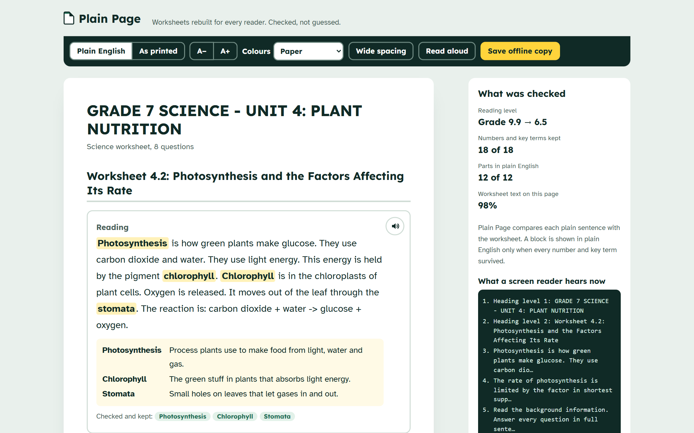
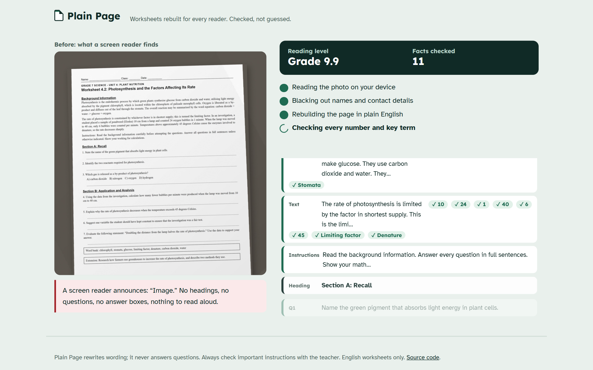
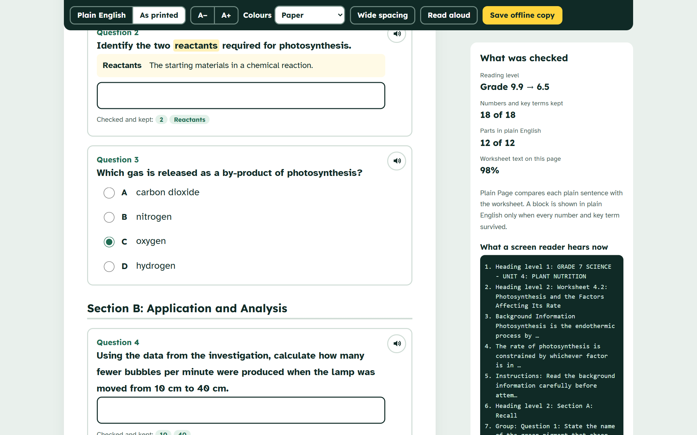
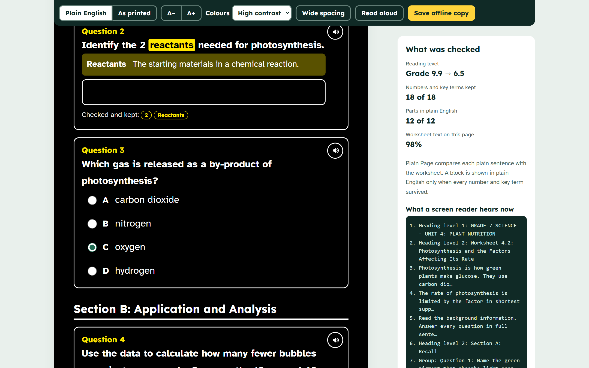
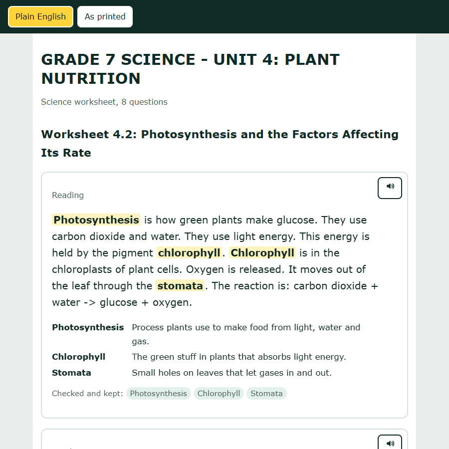
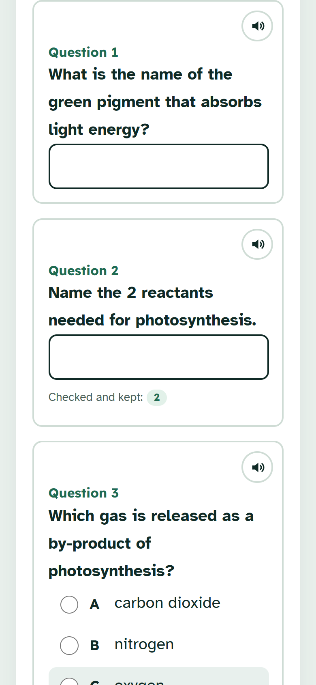

# Plain Page

**A worksheet a screen reader can't read is a lesson someone misses.**

Plain Page turns a photo of a printed worksheet into a real, accessible web page: headings a screen reader can jump between, every question as a labelled group with its own answer box, large clear type, plain English, key words explained in place, and read-aloud. Then it checks that every number and key term from the worksheet made it across. If the plain version drops one, you see the original wording instead.

**Try it:** https://plainpage-avy.pages.dev (press "Try a sample worksheet")

**Demo video (1:43):** https://youtu.be/tjmnPDrS6CM



## The barrier

A photocopied worksheet, photographed or scanned, is just an image. A screen reader announces "Image" and stops. A learner with low vision has to zoom into small print, a dyslexic learner faces dense justified text, and a learner still building their English meets "utilising" and "liberated as a by-product" in the first line.

| Before | After |
| --- | --- |
| A screen reader says "Image." No headings, no questions, no answer boxes. | "Heading level 1: Worksheet 4.2…", then "Group: Question 1: Name the green pigment… edit text". |
| Dense, small, justified text at about grade 10. | Short sentences at about grade 6, in large Atkinson Hyperlegible type. |
| Hard words with no help. | Key words highlighted and explained in place. |
| Answers on paper only. | Labelled answer boxes and choice buttons, usable by keyboard, saved in an offline copy. |



## How it works

1. **Read on the device.** Photos are read in the browser with Tesseract.js (WebAssembly, hosted on the site itself); PDFs with pdf.js. Photos never leave the device.
2. **Black out personal details.** Names on "Name:" lines, emails, phone numbers and ID numbers are blanked in the browser before any text is sent.
3. **Rebuild.** Gemini (`gemini-3.1-flash-lite`, with fallbacks) splits the worksheet into headings, reading text, instructions, questions and notes, using a fixed JSON schema. For each block it copies the original word for word and writes a plain-English version for a reading age of about 9.
4. **Check in code.** Before anything is shown:
   - every block's original text must really be on the worksheet (exact or OCR-tolerant match), or the block is dropped;
   - every number (digits, number words, fractions, decimals, percentages) and every key term in a block must appear in its plain version, or the page shows the original wording for that block, with a note saying what the plain version left out;
   - answer choices are kept only if they are printed on the worksheet;
   - any worksheet text that no block covers is shown at the end as printed, so nothing silently disappears.
5. **Read it your way.** Plain English or as printed, text size, wide spacing, four colour themes (paper, soft tint, high contrast, night), read-aloud with the spoken word highlighted, and **Save offline copy**: one HTML file with the same structure and the answers typed so far, which works offline on any device.

The model never answers questions, and the rules in `src/check` decide what is shown, not the model.

## Measured

Fictional worksheets with known question counts and answers, written and committed before their first run (`eval/`). `npm run eval -- 3 heldout`.

| | Development set (6 sheets x 2 runs) | Held-out set (4 sheets x 3 runs) |
| --- | --- | --- |
| Worksheet vs not a worksheet (a recipe, a parents' letter) | 12 / 12 | 12 / 12 |
| Questions found | 54 / 54 | 45 / 45 |
| Blocks invented by the model | 0 | 0 |
| Numbers and key terms lost on the page shown | 0 of 106 | 0 of 122 |
| Rewrites that dropped a fact, caught and shown as printed | 7 | 4 |
| Answers leaked into a rewritten question | 0 | 0 |
| Median time per worksheet (server call) | 4.7 s | 6.0 s |
| Average reading level, before → after | grade 7.6 → 5.7 | grade 4.9 → 5.5 |

Honest notes: the held-out sheets were already simple, and on those the reading level did not drop (the plain versions keep technical terms such as "denary" on purpose). The real gain there is structure: headings, labelled answers and read-aloud. The worksheets are synthetic and few; real worksheets will be messier. Result files: `eval/results/`.

**Accessibility:** the rebuilt page passes an axe-core audit (WCAG 2.1 A/AA and best practice) with 0 violations in all four colour themes, and a keyboard-only pass reaches and fills every answer (`scripts/e2e.mjs`). The screen-reader panel in the app is a simulation built from the page structure, not a real screen reader.

| | |
| --- | --- |
|  |  |
|  |  |

## Run it

```bash
npm install
echo 'GEMINI_API_KEY="your key"' > .dev.vars
npm run pages:dev        # http://localhost:8788
npm test                 # 28 unit tests for the checks
npm run eval -- 2        # accuracy test against the live model
```

Deploy: `npx wrangler pages deploy dist --project-name plainpage` and set the key with `npx wrangler pages secret put GEMINI_API_KEY --project-name plainpage`.

## Limits

- English worksheets only. Handwriting, diagrams and tables drawn as images are not read.
- Reading levels use the Flesch–Kincaid formula, a rough guide.
- Plain Page rewrites wording; it never answers questions. Check important instructions with the teacher.

## Credits

Tesseract.js and its English data (Apache-2.0), pdf.js (Apache-2.0), Atkinson Hyperlegible (Braille Institute, OFL) and Lexend (OFL) fonts, axe-core (MPL-2.0) for the audit, Google Gemini for the rebuild. The photo-reading and quote-matching code is reused from my earlier project [Fineprint](https://github.com/zuhairhalawa/fineprint) (MIT). The sample worksheet and all test worksheets are fictional.

MIT licence.
